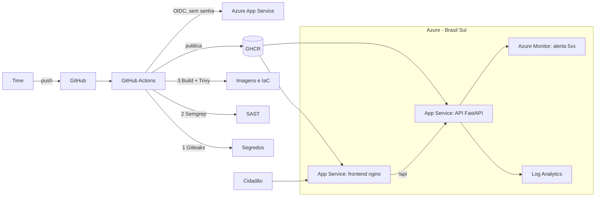

# Arquitetura e decisões de nuvem

Parte de nuvem e DevOps do AccessFlow (Azure, Brasil Sul).

## Visão geral

## Componentes

| Camada | O que é | Por quê |
|---|---|---|
| Frontend | nginx não-root em um App Service Linux | Serve a página e encaminha `/api` para a API |
| API | FastAPI em container, usuário não-root, `/health` e `/metrics` | Registra e lista ocorrências; expõe métricas |
| Plano | App Service Plan B1 (Linux), compartilhado pelos dois apps | Sem custo extra pelo segundo app |
| Logs | Log Analytics com configuração de diagnóstico | Logs HTTP, de console e métricas da API |
| Alerta | Azure Monitor, métrica Http5xx > 5 em 5 min, com action group | Avisa quando a API passa a falhar |
| IaC | Terraform (azurerm 4.x) em `terraform/` | Ambiente reproduzível por código |
| Pipeline | GitHub Actions em `.github/workflows/ci-cd.yml` | Segurança antes do deploy |

Prometheus e Grafana rodam localmente pelo `docker-compose` (pasta `monitoring/`), com o painel dos 4 sinais de ouro (latência, tráfego, erros e saturação). Na nuvem, a observabilidade é feita pelo Azure Monitor e pelo Log Analytics.

## Pipeline DevSecOps

1. **Gitleaks**: bloqueia o pipeline se houver segredo no código.
2. **Semgrep**: análise estática do código.
3. **Build e Trivy**: constrói as duas imagens e barra vulnerabilidades HIGH e CRITICAL corrigíveis. Um segundo Trivy verifica o repositório e o Terraform.
4. **Publicação** das imagens no GHCR, somente na `main`.
5. **Deploy** no App Service por login OIDC, sem senha guardada, e teste de fumaça em `/health`.

Evidência: o run com um token falso na branch `demo-segredo` falhou no Gitleaks e o run seguinte, sem o arquivo, passou.

## Responsabilidade compartilhada

| Microsoft cuida de | O time cuida de |
|---|---|
| Datacenter, rede física, hipervisor e sistema operacional do App Service | Código, dependências e imagens dos containers |
| Disponibilidade da plataforma App Service | Segredos (GitHub Secrets), permissões e identidade OIDC |
| Criptografia do serviço e conformidade da plataforma | Configuração do app, alertas e resposta a incidentes |

O acesso do pipeline à Azure usa uma identidade federada com a função Website Contributor, restrita ao grupo de recursos do projeto.

## LGPD e região

Tudo roda em Brasil Sul, então os dados ficam em território nacional. A política da assinatura de estudante restringe as regiões permitidas. As ocorrências da demonstração são fictícias e não guardam dados pessoais. O endereço digitado no registro é enviado ao serviço público de geocodificação do OpenStreetMap (Nominatim) para obter a coordenada; nenhum dado de pessoa vai junto. Em produção, seria necessário base legal, minimização de dados e política de retenção para qualquer dado de pessoa.

## Custo

O App Service Plan B1 Linux é o único custo relevante (estimativa de cerca de US$ 13 por mês; ver o print da calculadora de preços da Azure no relatório). O frontend reaproveita o mesmo plano. O Log Analytics tem franquia gratuita mensal suficiente para este volume. A assinatura Azure for Students cobre o período de avaliação.

## Decisões e limites

- A assinatura de estudante não tinha capacidade de VM nas regiões permitidas, então a hospedagem é feita em App Service, que atende ao requisito de container sem gerenciar servidor.
- O estado do Terraform é local. Em produção seria remoto e com bloqueio.
- O Semgrep ignora a regra que exige fixar tags de actions por hash. Em produção, as actions seriam fixadas por commit.
