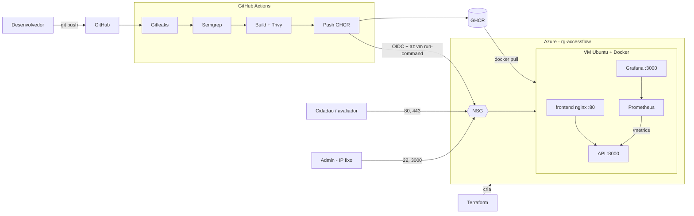

# Arquitetura (DevOps e Cloud)

## Responsabilidade compartilhada

| Camada | Quem cuida |
|---|---|
| Hardware, datacenter, hypervisor, rede fisica | Microsoft (Azure) |
| Sistema operacional da VM (patches, SSH, firewall/NSG) | Equipe |
| Docker, imagens, dependencias (Trivy) | Equipe |
| Codigo da aplicacao (Semgrep) e segredos (Gitleaks, GitHub Secrets) | Equipe |
| Dados pessoais e consentimento (LGPD) | Equipe, como controladora |

## Onde ficam os dados pessoais (LGPD)

Preencher com o que o produto realmente guarda. Pontos a declarar:

- Quais dados pessoais existem (ex.: contato do responsavel pelo estabelecimento) e a finalidade de cada um.
- Onde ficam: banco do produto na VM (regiao `brazilsouth`, dados no Brasil).
- Imagens do robo e da visao: nao devem capturar rostos. Se capturarem, anonimizar antes de armazenar.
- Minimizacao: a pagina publica do cidadao mostra apenas o status do acesso, sem dados pessoais.
- Segredos fora do codigo: GitHub Secrets (CI) e `.env` com permissao 600 na VM.

## Estimativa de custo (preencher com o print da Azure Pricing Calculator)

| Recurso | Dimensao | Custo mensal |
|---|---|---|
| VM `Standard_B2s` Linux | 730 h | ver calculadora |
| Disco `StandardSSD_LRS` 30 GB | 1 disco | ver calculadora |
| IP publico Standard estatico | 1 IP | ver calculadora |
| GHCR, GitHub Actions (repo publico) | | gratis |
| **Total** | | **preencher** |
